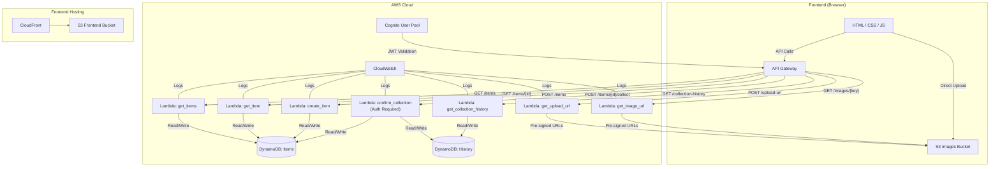

# AWS Deployment Guide

## Campus Lost & Found Management System — Complete AWS Setup

This guide walks you through setting up all AWS services **step by step** using the AWS Console. No CLI required.

> ⚠️ **Cost Warning:** Most services used are within the AWS Free Tier for 12 months. See the [Cost Checklist](#cost-checklist) at the end. Estimated cost for a demo: **$0 – $2/month**.

---

## Architecture Overview



---

## Step 1: Create DynamoDB Tables

### Table 1: CampusLostFoundItems

1. Go to **DynamoDB** → **Create table**
2. Settings:
   - **Table name:** `CampusLostFoundItems`
   - **Partition key:** `itemId` (String)
   - **Sort key:** leave empty
   - **Table settings:** Default settings (On-demand capacity for free tier)
3. Click **Create table**

### Table 2: CampusLostFoundHistory

1. Go to **DynamoDB** → **Create table**
2. Settings:
   - **Table name:** `CampusLostFoundHistory`
   - **Partition key:** `recordId` (String)
   - **Sort key:** leave empty
   - **Table settings:** Default settings
3. Click **Create table**

### DynamoDB Schema Reference

#### Items Table Schema:
| Attribute | Type | Description |
|-----------|------|-------------|
| `itemId` | String (PK) | Unique ID, e.g. "ITEM-A1B2C3D4" |
| `itemName` | String | Name of the item |
| `description` | String | Detailed description |
| `category` | String | Electronics, Clothing, etc. |
| `reportType` | String | "LOST" or "FOUND" |
| `location` | String | Where item was lost/found |
| `reportDate` | String | Date in YYYY-MM-DD format |
| `imageKey` | String | S3 object key for photo |
| `status` | String | "ACTIVE" |
| `collectionStatus` | String | "PENDING" or "COLLECTED" |
| `claimantName` | String | Name of person who collected |
| `organiserName` | String | Name of verifying organiser |
| `organiserId` | String | Cognito sub ID of organiser |
| `collectionTimestamp` | String | ISO datetime of collection |
| `createdAt` | String | ISO datetime of creation |
| `updatedAt` | String | ISO datetime of last update |
| `isDemo` | Boolean | Whether this is demo data |

#### History Table Schema:
| Attribute | Type | Description |
|-----------|------|-------------|
| `recordId` | String (PK) | Unique ID, e.g. "COL-A1B2C3D4" |
| `itemId` | String | Reference to the collected item |
| `itemName` | String | Copied for easy display |
| `category` | String | Copied for easy display |
| `claimantName` | String | Person who collected the item |
| `organiserName` | String | Organiser who verified |
| `organiserId` | String | Organiser's Cognito sub |
| `organiserEmail` | String | Organiser's email |
| `collectionTimestamp` | String | When collection happened |
| `status` | String | Always "COLLECTED" |
| `isDemo` | Boolean | Whether demo data |

---

## Step 2: Create S3 Bucket for Images

1. Go to **S3** → **Create bucket**
2. Settings:
   - **Bucket name:** `campus-lost-found-images-YOURUNIQUEID` (must be globally unique)
   - **Region:** Same as your Lambda functions (e.g., `us-east-1`)
   - **Block Public Access:** ✅ **Block ALL public access** (keep this ON)
   - **Versioning:** Disabled (not needed for a student project)
3. Click **Create bucket**

### Add CORS Configuration

1. Go to your bucket → **Permissions** → **CORS**
2. Paste this configuration:

```json
[
    {
        "AllowedHeaders": ["*"],
        "AllowedMethods": ["PUT", "GET"],
        "AllowedOrigins": ["*"],
        "ExposeHeaders": ["ETag"],
        "MaxAgeSeconds": 3600
    }
]
```

> In production, replace `"*"` in AllowedOrigins with your actual domain.

---

## Step 3: Create IAM Role for Lambda

1. Go to **IAM** → **Roles** → **Create role**
2. **Trusted entity:** AWS Service → Lambda
3. **Permissions:** Attach these managed policies:
   - `AWSLambdaBasicExecutionRole` (for CloudWatch logs)
4. **Role name:** `CampusLostFoundLambdaRole`
5. Click **Create role**

### Add Custom Inline Policy

1. Go to the role → **Add permissions** → **Create inline policy**
2. Switch to **JSON** editor and paste:

```json
{
    "Version": "2012-10-17",
    "Statement": [
        {
            "Sid": "DynamoDBAccess",
            "Effect": "Allow",
            "Action": [
                "dynamodb:GetItem",
                "dynamodb:PutItem",
                "dynamodb:UpdateItem",
                "dynamodb:Scan",
                "dynamodb:Query"
            ],
            "Resource": [
                "arn:aws:dynamodb:*:*:table/CampusLostFoundItems",
                "arn:aws:dynamodb:*:*:table/CampusLostFoundHistory"
            ]
        },
        {
            "Sid": "S3ImageAccess",
            "Effect": "Allow",
            "Action": [
                "s3:PutObject",
                "s3:GetObject",
                "s3:HeadObject"
            ],
            "Resource": "arn:aws:s3:::campus-lost-found-images-*/*"
        }
    ]
}
```

3. **Policy name:** `CampusLostFoundPolicy`
4. Click **Create policy**

---

## Step 4: Create Lambda Functions

Create **7 Lambda functions**. For each one:

1. Go to **Lambda** → **Create function**
2. **Author from scratch**
3. **Runtime:** Python 3.12
4. **Execution role:** Use existing role → `CampusLostFoundLambdaRole`
5. **Create function**
6. Copy the code from the `lambda/` folder into the inline editor
7. Set environment variables

### Function List:

| Function Name | Source File | Environment Variables |
|---------------|------------|----------------------|
| `CampusLF-GetItems` | `lambda/get_items/lambda_function.py` | `ITEMS_TABLE=CampusLostFoundItems` |
| `CampusLF-GetItem` | `lambda/get_item/lambda_function.py` | `ITEMS_TABLE=CampusLostFoundItems` |
| `CampusLF-CreateItem` | `lambda/create_item/lambda_function.py` | `ITEMS_TABLE=CampusLostFoundItems` |
| `CampusLF-ConfirmCollection` | `lambda/confirm_collection/lambda_function.py` | `ITEMS_TABLE=CampusLostFoundItems`, `HISTORY_TABLE=CampusLostFoundHistory` |
| `CampusLF-GetHistory` | `lambda/get_collection_history/lambda_function.py` | `HISTORY_TABLE=CampusLostFoundHistory` |
| `CampusLF-GetUploadUrl` | `lambda/get_upload_url/lambda_function.py` | `IMAGES_BUCKET=campus-lost-found-images-YOURID` |
| `CampusLF-GetImageUrl` | `lambda/get_image_url/lambda_function.py` | `IMAGES_BUCKET=campus-lost-found-images-YOURID` |

### Setting Environment Variables:
1. In each Lambda → **Configuration** → **Environment variables** → **Edit**
2. Add the variables listed above
3. Click **Save**

### Setting Timeout:
1. Each Lambda → **Configuration** → **General configuration** → **Edit**
2. Set **Timeout** to **15 seconds** (default 3s is too short)
3. Click **Save**

---

## Step 5: Create API Gateway

1. Go to **API Gateway** → **Create API** → **REST API** → **Build**
2. **API name:** `CampusLostFoundAPI`
3. Click **Create API**

### Create Resources and Methods:

#### /items
1. **Create Resource:** path = `/items`
2. **Create Method:** `GET` → Integration = Lambda → Function = `CampusLF-GetItems`
3. **Create Method:** `POST` → Integration = Lambda → Function = `CampusLF-CreateItem`
4. **Enable CORS** on `/items` resource

#### /items/{itemId}
1. **Create Resource** under `/items`: path = `{itemId}`
2. **Create Method:** `GET` → Lambda → `CampusLF-GetItem`
3. **Enable CORS** on `/items/{itemId}`

#### /items/{itemId}/collect
1. **Create Resource** under `{itemId}`: path = `collect`
2. **Create Method:** `POST` → Lambda → `CampusLF-ConfirmCollection`
3. ⚠️ This method needs **Cognito Authorization** (see Step 6)
4. **Enable CORS** on `/items/{itemId}/collect`

#### /collection-history
1. **Create Resource:** path = `/collection-history`
2. **Create Method:** `GET` → Lambda → `CampusLF-GetHistory`
3. **Enable CORS**

> **Privacy note:** The `CampusLF-GetHistory` Lambda checks for a valid JWT.
> - **Authenticated organisers** see full records including claimant names.
> - **Unauthenticated requests** receive **redacted** records — claimant names
>   are masked and organiser emails are omitted.
>
> You do **not** need to attach the Cognito authoriser to this endpoint at
> the API Gateway level (leave it public). The Lambda inspects the JWT
> itself and returns the appropriate view. If you want to block
> unauthenticated access entirely, attach the `CognitoAuth` authoriser
> to this method as well.

#### /upload-url
1. **Create Resource:** path = `/upload-url`
2. **Create Method:** `POST` → Lambda → `CampusLF-GetUploadUrl`
3. **Enable CORS**

#### /images/{imageKey}
1. **Create Resource:** path = `/images`
2. **Create Resource** under `/images`: path = `{imageKey}`
3. **Create Method:** `GET` → Lambda → `CampusLF-GetImageUrl`
4. **Enable CORS**

### Deploy API:
1. **Actions** → **Deploy API**
2. **Stage name:** `prod`
3. Click **Deploy**
4. Copy the **Invoke URL** (e.g., `https://abc123.execute-api.us-east-1.amazonaws.com/prod`)

---

## Step 6: Create Cognito User Pool (Phase 4)

1. Go to **Cognito** → **Create user pool**
2. Settings:
   - **Pool name:** `CampusLostFoundOrganisers`
   - **Sign-in:** Email
   - **Password policy:** At least 8 characters
   - **MFA:** Optional (recommended for production)
3. **App client:**
   - **App client name:** `CampusLFWebApp`
   - **Generate client secret:** ❌ **NO** (public client for browser use)
4. Click **Create user pool**

### Create Organiser User:
1. Go to your user pool → **Users** → **Create user**
2. Email: `admin@campus.edu`
3. Temporary password: Set one
4. Mark email as verified

### Add Cognito Authorizer to API Gateway:
1. Go to **API Gateway** → Your API → **Authorizers**
2. **Create Authorizer:**
   - **Name:** `CognitoAuth`
   - **Type:** Cognito
   - **User Pool:** Select your pool
   - **Token Source:** `Authorization`
3. Go to `/items/{itemId}/collect` → POST method
4. **Method Request** → **Authorization** → Select `CognitoAuth`
5. **Re-deploy** the API to `prod` stage

---

## Step 7: Host Frontend on S3 + CloudFront

### S3 Static Website:
1. Create a **new** S3 bucket: `campus-lost-found-frontend-YOURID`
2. **Properties** → **Static website hosting** → **Enable**
3. **Index document:** `index.html`
4. Upload all frontend files (`index.html`, `css/`, `js/`)

### CloudFront Distribution:
1. Go to **CloudFront** → **Create distribution**
2. **Origin domain:** Your S3 bucket website endpoint
3. **Viewer protocol policy:** Redirect HTTP to HTTPS
4. Click **Create distribution**
5. Use the CloudFront URL as your site's public URL

---

## Step 8: Configure Frontend for AWS

1. Copy `js/env.example.js` to `js/env.js`
2. Fill in your AWS values:
   - `apiBaseUrl`: Your API Gateway invoke URL
   - `cognitoUserPoolId`: Your Cognito User Pool ID
   - `cognitoClientId`: Your App Client ID
   - `region`: Your AWS region
   - `s3Bucket`: Your images bucket name
3. Add this line to `index.html` **before** the config.js script:
   ```html
   <script src="js/env.js"></script>
   ```
4. Re-upload to S3 frontend bucket

---

## Cost Checklist

| Service | Free Tier | Expected Cost |
|---------|-----------|---------------|
| DynamoDB | 25 GB storage, 25 RCU/WCU | **$0** (student project) |
| Lambda | 1M requests/month, 400K GB-seconds | **$0** |
| API Gateway | 1M API calls/month | **$0** |
| S3 | 5 GB storage, 20K GET, 2K PUT | **$0** |
| CloudFront | 1 TB transfer/month | **$0** |
| Cognito | 50K MAU | **$0** |
| CloudWatch | 5 GB logs | **$0** |
| CloudTrail | Management events free | **$0** |

> ⚠️ **S3 data events** (object-level logging in CloudTrail) cost ~$0.10 per 100K events. Do NOT enable these for the demo unless your professor requires it.

---

## Cleanup Guide

To avoid any charges after your demo, delete these resources **in this order**:

1. **CloudFront:** Disable → wait → Delete distribution
2. **S3:** Empty buckets → Delete both buckets
3. **API Gateway:** Delete API
4. **Lambda:** Delete all 7 functions
5. **DynamoDB:** Delete both tables
6. **Cognito:** Delete user pool
7. **IAM:** Delete role `CampusLostFoundLambdaRole`
8. **CloudWatch:** Delete log groups starting with `/aws/lambda/CampusLF-`

Run through this checklist after your demo is complete.
