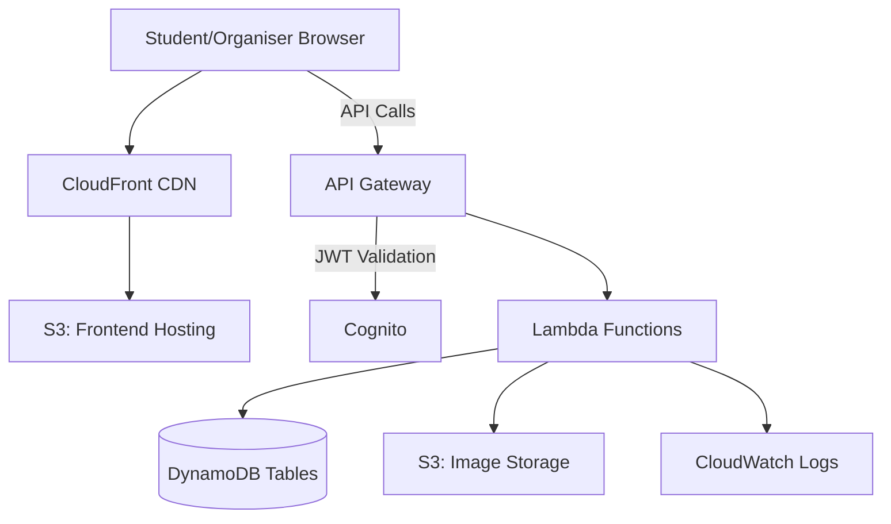

# Project Report

## Campus Lost and Found Management System with Collection Verification and Organiser Tracking Using AWS Cloud

---

## Abstract

This project presents a web-based Campus Lost and Found Management System designed to streamline the process of reporting, tracking, and managing lost and found items within a college campus. The system features a secure collection verification workflow where authorised organisers verify item handovers, creating an auditable record of every transaction. Built using a serverless AWS architecture, the system leverages Amazon DynamoDB for data persistence, AWS Lambda for backend logic, Amazon API Gateway for RESTful endpoints, Amazon S3 for secure photo storage, and Amazon Cognito for organiser authentication. The frontend is a responsive single-page application built with HTML5, CSS3, and JavaScript, supporting both a local demonstration mode and full AWS integration. The project demonstrates practical application of cloud computing, serverless architecture, and security best practices in a real-world campus management scenario.

---

## 1. Introduction

### 1.1 Problem Statement
College campuses frequently deal with lost and found items. Traditional methods — physical logbooks, notice boards, or informal WhatsApp groups — are unreliable, lack accountability, and provide no audit trail for item handovers. When a student claims a found item, there is often no verified record of who collected it or which staff member approved the handover.

### 1.2 Proposed Solution
A cloud-based web application that allows students to report lost and found items with photographs, search and filter reported items, and enables authorised organisers to verify and record item collections with full audit trails.

### 1.3 Scope
- Web application accessible from any device with a browser
- Lost and found item reporting with photo uploads
- Search and filter functionality
- Secure organiser authentication
- Collection verification with audit logging
- Demonstration mode for offline usage

---

## 2. Objectives

1. Develop a responsive web application for campus lost and found management.
2. Implement secure item collection verification using organiser authentication.
3. Create an append-only audit trail for all collection transactions.
4. Deploy the application using AWS serverless services to minimise infrastructure costs.
5. Implement security best practices including input validation, least-privilege IAM, and JWT authentication.
6. Provide both a local demonstration mode and a production-ready AWS mode.
7. Ensure the system prevents duplicate collections and unauthorised status changes.

---

## 3. Literature Review / Background

### 3.1 Cloud Computing
Cloud computing provides on-demand computing resources over the internet. AWS (Amazon Web Services) is the leading cloud provider, offering services that eliminate the need to manage physical servers.

### 3.2 Serverless Architecture
Serverless computing allows developers to build applications without managing servers. AWS Lambda executes code in response to events, scaling automatically and charging only for compute time used.

### 3.3 NoSQL Databases
Amazon DynamoDB is a fully managed NoSQL database that provides single-digit millisecond latency at any scale. Its key-value storage model is ideal for item records that need fast lookups by ID.

### 3.4 RESTful API Design
REST (Representational State Transfer) APIs use HTTP methods (GET, POST, PUT, DELETE) to perform operations on resources. Amazon API Gateway provides a managed service for creating, publishing, and securing REST APIs.

### 3.5 Authentication and Authorization
Amazon Cognito provides user sign-up, sign-in, and access control. JWT (JSON Web Tokens) are used to securely transmit identity information between the client and server.

---

## 4. Methodology

### 4.1 Development Approach
The project followed an iterative development approach across six phases:

| Phase | Focus |
|-------|-------|
| Phase 1 | Frontend development, local demo mode |
| Phase 2 | Testing, bug fixes, feature enhancements |
| Phase 3 | AWS backend implementation |
| Phase 4 | Cognito authentication integration |
| Phase 5 | S3 photo upload, CloudWatch, CloudTrail |
| Phase 6 | Deployment, documentation, testing |

### 4.2 Technology Stack

| Layer | Technology |
|-------|-----------|
| Frontend | HTML5, CSS3, JavaScript (ES6+) |
| Backend | AWS Lambda (Python 3.12) |
| Database | Amazon DynamoDB |
| API | Amazon API Gateway (REST) |
| Storage | Amazon S3 (pre-signed URLs) |
| Authentication | Amazon Cognito |
| Hosting | Amazon S3 + CloudFront |
| Monitoring | Amazon CloudWatch |
| Auditing | AWS CloudTrail |

### 4.3 Design Patterns

1. **Data Adapter Pattern:** Abstracts data operations behind a common interface, allowing seamless switching between local demo mode and AWS mode.
2. **Server-Side Identity Derivation:** Organiser identity is derived from verified JWT claims, not from user input.
3. **Conditional Writes:** DynamoDB conditional expressions prevent race conditions and duplicate collections.
4. **Append-Only Audit Log:** Collection history records are only created, never modified or deleted.
5. **Pre-signed URLs:** S3 objects are accessed through time-limited signed URLs, keeping the bucket private.

---

## 5. System Architecture

### 5.1 Architecture Diagram

### 5.2 Data Flow

1. **Report Item:** Browser → API Gateway → Lambda `create_item` → DynamoDB
2. **View Items:** Browser → API Gateway → Lambda `get_items` → DynamoDB → Browser
3. **Upload Photo:** Browser → Lambda `get_upload_url` → S3 pre-signed URL → Browser uploads directly to S3
4. **Confirm Collection:** Browser (with JWT) → API Gateway (validates JWT) → Lambda `confirm_collection` → DynamoDB (conditional write) + CollectionHistory

### 5.3 DynamoDB Schema

**Items Table:** Partition Key = `itemId` (String)
**History Table:** Partition Key = `recordId` (String)

---

## 6. Implementation Details

### 6.1 Frontend
- Single-page application with client-side navigation
- Responsive design using CSS Grid and Flexbox
- Inter font family from Google Fonts
- Blue-and-white colour scheme with glassmorphism accents
- Staggered card animations for visual engagement
- Form validation with inline error messages
- Toast notifications for user feedback
- Modal-based item detail view

### 6.2 Backend Security Measures
1. **Input sanitisation:** All text input is stripped of HTML tags on the server
2. **Field validation:** Required fields and allowed values are checked server-side
3. **Conditional writes:** `ConditionExpression: collectionStatus = PENDING` prevents duplicate collections
4. **JWT authentication:** Organiser endpoints require valid Cognito tokens
5. **Identity derivation:** Organiser name/ID from JWT `sub` claim, not request body
6. **Pre-signed URLs:** S3 access is time-limited and type-restricted
7. **Least-privilege IAM:** Lambda role has only the permissions it needs
8. **CORS headers:** Restrict cross-origin access

### 6.3 Collection Verification Workflow
1. Organiser logs in (Cognito authentication)
2. Opens pending item details
3. Enters claimant's name
4. System auto-fills organiser identity from JWT
5. Submits confirmation
6. Lambda performs conditional DynamoDB update
7. Append-only audit record created in History table
8. Item status changes to COLLECTED
9. Dashboard and history view update

---

## 7. Results

### 7.1 Features Implemented
- ✅ Dashboard with summary statistics and item cards
- ✅ Search by item name and filter by category/status
- ✅ Report lost item with photo upload
- ✅ Report found item with lost-item suggestion matching
- ✅ Item detail view with full information
- ✅ Organiser authentication and authorization
- ✅ Collection verification with audit trail
- ✅ Collection history table
- ✅ Duplicate collection prevention
- ✅ Responsive mobile design
- ✅ Local demo mode and AWS mode

### 7.2 Screenshots
*[Include screenshots of: Dashboard, Report Form, Item Detail, Organiser Panel, Collection History]*

---

## 8. Limitations

1. **Search:** Text search uses client-side filtering; for large datasets, DynamoDB full-text search would require Amazon OpenSearch integration.
2. **Real-time updates:** The app uses manual refresh; WebSocket-based real-time updates would improve the experience.
3. **Notifications:** No email/SMS notifications when a matching item is found.
4. **Multi-tenancy:** The system is designed for a single campus; multi-campus support would require additional architecture.
5. **Offline support:** The app requires an internet connection in AWS mode.
6. **Image moderation:** No automated content moderation for uploaded photos.

---

## 9. Future Enhancements

1. Email notifications when a found item matches a lost report
2. AI-based image matching between lost and found items
3. Mobile app (React Native or Flutter)
4. QR code-based collection verification
5. Multi-language support
6. Admin dashboard with analytics
7. Integration with campus student database

---

## 10. Conclusion

The Campus Lost and Found Management System successfully demonstrates the practical application of AWS serverless architecture in solving a real campus management problem. The system provides a secure, auditable, and user-friendly way to manage lost and found items, with particular emphasis on the collection verification workflow that ensures accountability. The use of conditional database writes, JWT-based authentication, and append-only audit logs demonstrates enterprise-grade security practices in a student-friendly implementation. The dual-mode architecture (local demo and AWS production) makes the system easy to develop, test, and deploy.

---

## References

1. Amazon Web Services Documentation — https://docs.aws.amazon.com/
2. AWS Lambda Developer Guide — https://docs.aws.amazon.com/lambda/
3. Amazon DynamoDB Developer Guide — https://docs.aws.amazon.com/dynamodb/
4. Amazon API Gateway Developer Guide — https://docs.aws.amazon.com/apigateway/
5. Amazon Cognito Developer Guide — https://docs.aws.amazon.com/cognito/
6. Amazon S3 Developer Guide — https://docs.aws.amazon.com/s3/
7. AWS Well-Architected Framework — https://aws.amazon.com/architecture/well-architected/
8. OWASP Web Security Guidelines — https://owasp.org/
